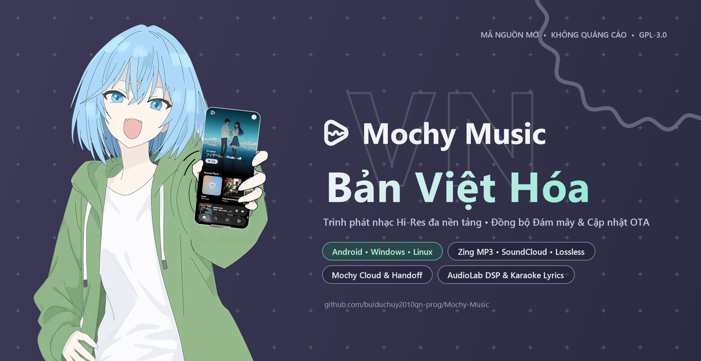

# Mochy Music — Bản Việt Hóa Toàn Diện (Android • Windows • Linux)

**Ứng dụng nghe nhạc mã nguồn mở hiện đại, không quảng cáo dành cho Android (`.apk`), Windows (`.exe`) và Linux (`.AppImage` / `.deb`) — được chỉnh sửa, Việt hóa toàn diện 100% và tích hợp cập nhật tự động (OTA) bởi [Đức Huy (@buiduchuy2010qn-prog)](https://github.com/buiduchuy2010qn-prog).**

  
  
  
  

---

## 🌟 Điểm nổi bật của Bản Chỉnh Sửa & Việt Hóa (`@buiduchuy2010qn-prog`)

- ⚡ **Kiểm tra sâu toàn app, vá rò rỉ tài nguyên & tối ưu pin/RAM (v12.3.2):** Gộp hơn 15 HTTP client vào `AppProxy.sharedClient` dùng chung thread pool/connection pool; vá vòng lặp proxy 407 & đóng kín mọi socket HTTP/URL stream (`NewPipe`, `YTPlayerUtils`, `PoTokenWebView`, `mochyupdater`); dọn rò rỉ bộ nhớ & coroutine tại `MusicService.onDestroy()` (ngăn khởi tạo luồng `Crossmix` khi dừng service, xóa sạch player map khi crossfade/crossmix, hủy `MediaLibrarySessionCallback` & `Scope` theo `SupervisorJob`); ngắt polling `progressState`, cảm biến nghiêng 50Hz và animation frame loop karaoke/nền `Apple Music`/`Kawarp` khi tạm dừng hoặc bị che khuất kèm cache RadialGradient qua `drawWithCache`; sửa thiếu `@Transaction` Room DAO, chặn `runBlocking` ở `incrementPlayCount`, bọc `EntitySyncScope` an toàn và giới hạn kích thước mọi cache trong RAM.
- ✨ **Tinh chỉnh toàn diện, AI Gemini & Việt hóa 100% (v12.3.1):** Sửa lỗi pill mờ ở Re'cap (`MonthPage` & `PersonaPage`), chống tràn chữ và thống nhất phản hồi xúc giác `pressBounce` / `RemoteFocus`; tự động chuẩn hóa endpoint Gemini OpenAI-compatible (`/chat/completions`) mặc định `gemini-3.5-flash-lite` cho Dịch lời bài hát kèm hỗ trợ stream chế độ `Romanized`, sửa prompt `system` cho Mistral và ánh xạ DeepL Tiếng Việt; hoàn thiện nốt Tiếng Việt tại trang Nghệ sĩ, Cast, About, Nhập nhạc & Khôi phục sao lưu cùng chuẩn hóa thương hiệu Mochy Music và tăng độ ổn định kết nối mạng.
- 🌐 **Việt hóa 100% toàn diện:** Toàn bộ giao diện, trình phát nhạc, lời bài hát Karaoke, AudioLab (Equalizer / AutoEq / Audio Pass), Module mở rộng, Kết nối thiết bị, cài đặt và thông báo đều được dịch sang Tiếng Việt tự nhiên (`values-vi` & `values-vi-rVN` đồng bộ 100%).
- 🎬 **Xuất Video Re'cap 60fps, Ảnh Từng Phần & Bộ 4 Nâng cấp Re'cap Chuẩn Hãng (v12.3.0):** Giữ nguyên 100% hoạt ảnh Re'cap gốc của Mochy (chữ khổng lồ xoay 90°, số lăn odometer, thanh tiến độ ánh sáng, vòng quay Nghệ sĩ #1, lưới bìa nghiêng Bài hát #1, hóa đơn cuộn mượt tới hết dòng và thẻ hồ sơ ID Card kèm nền chuyển sắc MeshGradient), nay bổ sung thêm **8 Danh hiệu "Hệ người nghe" Tiếng Việt** (*Cú Đêm Suy Ngẫm, Hệ Lụy Một Bài, Fan Cứng Chung Thủy...*), **Chuỗi ngày nghe liên tiếp (Streak) & Ngày bùng nổ nhất**, **So sánh biến động với kỳ trước**, **Lưu Top 25 Re'cap thành Playlist & chép mã `mochypl1:` chỉ với 1 chạm**, cùng tính năng xuất **Video MP4 1080p @ 60fps kèm nhạc nền** và **Ảnh PNG từng phần (kèm Hóa đơn đầy đủ không bị cắt)**.
- 🧩 **Hệ sinh thái Module nguồn nhạc, Audio Lab 8D & Tiện ích Widget (v12.0.0):** Giữ nguyên 100% nền tảng Mochy Music 8.4.2 gốc và bộ ổn định DAC/USB Audio PrecisionSink, PeakLimiter PCM, Spatial LFE 120Hz, CrossMix + Joint Limiter, đồng thời bổ sung **Âm thanh vòm 8D (8D Audio)**, **Tùy chỉnh Thu phóng ảnh bìa (Cover Zoom)**, **Chọn chất lượng Canvas Apple Music & Video YouTube**, **Widget Màn hình chính 2x2 / 4x1 / 4x2 kèm lời bài hát chuyển cảnh**, **Discord RPC hỗ trợ Spotify Canvas & Bìa động Apple Music (GIF)**, khôi phục bài đã thích (**YouTube Likes Memory**), đồng bộ Cloud + sao lưu ngoại tuyến cho cài đặt 8D / Cover Zoom / Canvas, cùng các module **Zing MP3**, **SoundCloud**, **Monochrome (Hi-Res Lossless FLAC)**, **JioSaavn**, **Apple Music**, **Wikipedia Tiếng Việt** và **Look Modules** (*Kính Lỏng Trong Suốt, Đen Tuyệt Đối OLED, iPod Cổ Điển, Đĩa Than Phòng Thu*).
- ☁️ **Mochy Cloud (Liên kết hai chiều Google ↔ `@username` trên cùng 1 tài khoản, Bảo mật Edge + RLS chống spam), Cloud Handoff & Trung tâm Tạo/Nhập Playlist (`+`):** Hỗ trợ **Tiếp tục với Google** (OAuth PKCE an toàn qua Chrome trên máy), đăng nhập `@username` qua Edge Function không lộ Gmail, khóa RLS/giới hạn DB chống spam, liên kết trực tiếp Google vào tài khoản `@username` hiện có hoặc đặt mật khẩu & đổi `@username` trực tiếp để sang máy khác vẫn vào đúng 1 tài khoản duy nhất, đồng bộ hai chiều bền vững Yêu thích, Playlist cá nhân, Lịch sử nghe, Thẻ ID/Avatar; chuyển tiếp bài đang phát tức thời giữa các thiết bị (**Cloud Handoff**) và nút **`+`** trực tiếp tại Thư viện để tạo mới hoặc nhập nhanh mã **`mochypl1:`** / tệp **`.mochypl`**.
- 🔐 **Chọn & Đổi nhanh tài khoản Google trên máy cho YouTube Music (Smart Gmail Picker & Account Switcher):** Tự điền sẵn Gmail đã liên kết từ Mochy Cloud, tích hợp nút **Chọn Gmail trên máy**, **Dùng Gmail khác** (tự xóa cookie WebView tránh dính phiên cũ), nút **Đổi tài khoản** ngay ở màn `Nhập gì`, hỗ trợ Autofill và lưu cookie bền vững.
- 🎤 **Lời bài hát Karaoke, Nhận diện nhạc & Wikipedia Tiếng Việt:** Hỗ trợ lời bài hát đồng bộ từng từ/dòng, tiện ích lời nổi, tra cứu tiểu sử ca sĩ/bài hát qua **Wikipedia Tiếng Việt**, nhận diện nhạc xung quanh và nhập nhạc nhanh từ link **TikTok / SoundCloud**.
- 📱 **Hỗ trợ cả ARM64 & Universal (32-bit/64-bit, Android 7.0+):** Phát hành song song bản `arm64` cho máy đời mới và bản `universal` cho máy 32-bit `armeabi-v7a` (Galaxy J6 / J7 Android 8.1), kèm công tắc **Tối ưu cho máy yếu** ngay trong **Cài đặt › Tùy chỉnh › Làm mờ** (tự động bật lần đầu trên Android ≤ 8.1 / RAM ≤ 3 GB; tắt đi tự khôi phục cấu hình cũ).
- 🔄 **Pop-up Cập nhật tự động (OTA) đồng bộ khi mở ứng dụng:** Khi có phiên bản mới trên GitHub Releases, cả bản **Android** và bản **Windows / Linux** đều tự động hiện bảng thông báo nổi (kèm pop-up **Có gì mới**) để bạn xem nội dung cập nhật và nhấn **"Cập nhật ngay"** cài đè trực tiếp không mất dữ liệu.
- 📤 **Chia sẻ bài hát & Đăng lên Locket nhanh trong menu 3 chấm (`⋮`):** Đưa nút **Chia sẻ bài hát** và **Đăng lên Locket** ra ngay menu 3 chấm (`⋮`) của trình phát nhạc và danh sách bài hát.
- 💻 **Hỗ trợ đa nền tảng trong cùng 1 kho mã nguồn:** Tự động đóng gói đầy đủ bộ cài kèm số phiên bản rõ ràng cho **Android (`.apk`)**, **Windows (`.exe` Setup & Portable)** và **Linux (`.AppImage` & `.deb`)**.

---

## 📥 Tải về & Hướng dẫn cài đặt (Kèm số phiên bản trong tên tệp)

👉 Mở trang **[Bản phát hành mới nhất (Releases)](https://github.com/buiduchuy2010qn-prog/Mochy-Music/releases/latest)** và chọn tệp tương ứng với thiết bị của bạn:

| Thiết bị / Hệ điều hành | Tên tệp tải về (kèm số phiên bản) | Ghi chú |
| :--- | :--- | :--- |
| 📱 **Android 64-bit (Khuyên dùng)** | `Mochy-Music-v<Phiên_bản>-vi-arm64.apk` | Tối ưu cho hầu hết điện thoại Android 7.0+ đời mới, hỗ trợ cài đè OTA |
| 📱 **Android Universal (32-bit / 64-bit, J6/J7 Android 8.1)** | `Mochy-Music-v<Phiên_bản>-vi-universal.apk` | Dùng cho máy 32-bit `armeabi-v7a` (như Galaxy J6 / J7 Android 8.1); tự bật chế độ tối ưu RAM/GPU trong Cài đặt › Tùy chỉnh › Làm mờ |
| 🪟 **Máy tính Windows (Khuyên dùng)** | `Mochy-Music-v<Phiên_bản>-Windows-x64-Setup.exe` | Bộ cài đặt chuẩn Windows, hỗ trợ tự động tải & cài đè OTA |
| 🪟 **Máy tính Windows (Chạy ngay)** | `Mochy-Music-v<Phiên_bản>-Windows-x64-Portable.exe` | Bản Portable mở lên dùng ngay không cần cài đặt |
| 🐧 **Máy tính Linux (Mọi bản phân phối)** | `Mochy-Music-v<Phiên_bản>-Linux-x86_64.AppImage` | Cấp quyền thực thi (`chmod +x`) và chạy trực tiếp |
| 🐧 **Ubuntu / Debian / Linux Mint** | `Mochy-Music-v<Phiên_bản>-Linux-amd64.deb` | Cài đặt qua `sudo apt install ./Mochy-Music-v*-Linux-amd64.deb` |

---

## 📜 Bản quyền & Ghi công Tác giả (License & Credits)

Dự án được phát hành theo giấy phép mã nguồn mở **[GNU General Public License v3.0 (GPL-3.0)](LICENSE)**:

| Vai trò | Tác giả / Nhà phát triển | Liên kết |
| :--- | :--- | :--- |
| 🌟 **Người chỉnh sửa, Việt hóa 100% & Phát triển Đa nền tảng / OTA** | **Đức Huy (`@buiduchuy2010qn-prog`)** | [Kho mã nguồn chính thức (`buiduchuy2010qn-prog/Mochy-Music`)](https://github.com/buiduchuy2010qn-prog/Mochy-Music) |
| 👑 **Tác giả gốc dự án (Original Authors)** | **Roo (`@realidkroo` / mochyDH P ASHOKAN)** & **key (`@realkeichi`)** | [Ủng hộ tác giả gốc trên Ko-fi](https://ko-fi.com/idkroo) |
| 🤝 **Dự án nền tảng (Upstream Base)** | **ViviMusic (`@vivizzz007`)** & **Metrolist (`@mostafaalagamy`)** | [ViviMusic](https://github.com/vivizzz007/vivi-music) · [Metrolist](https://github.com/mostafaalagamy/Metrolist) |